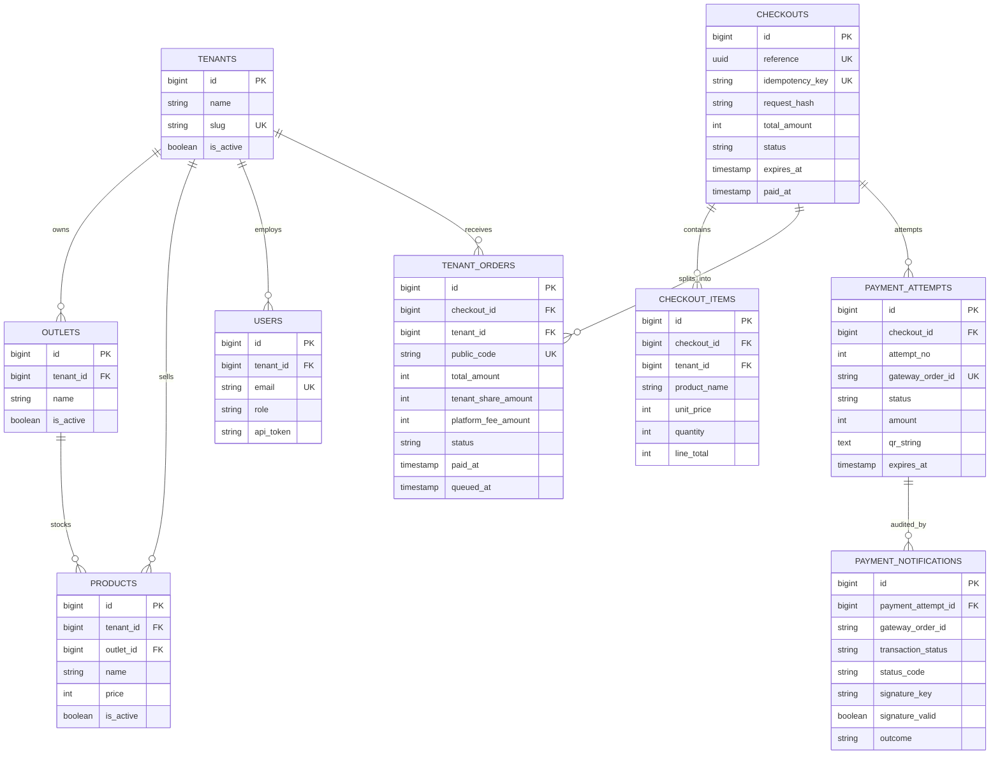
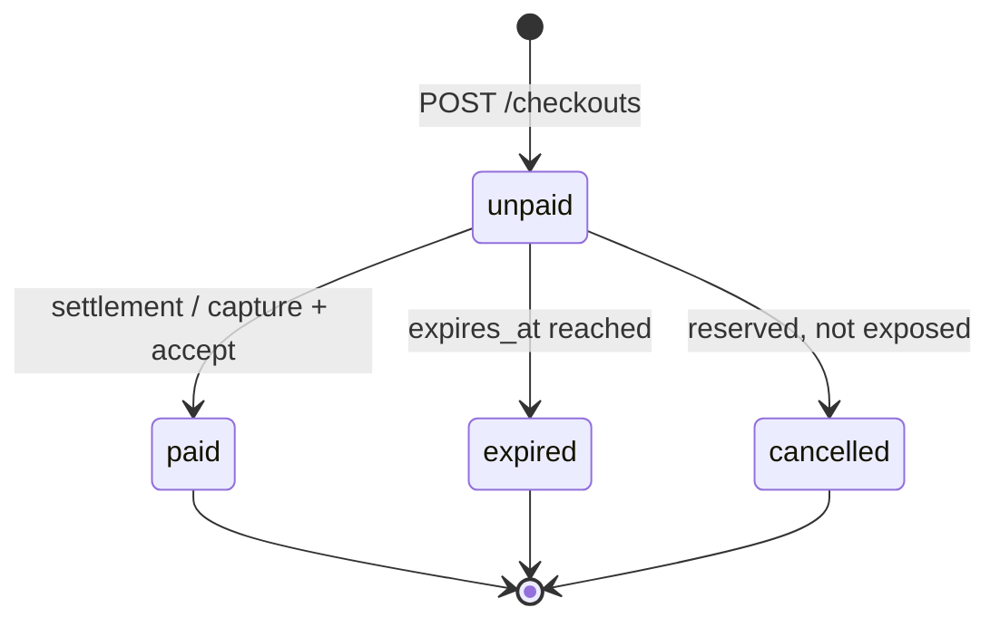
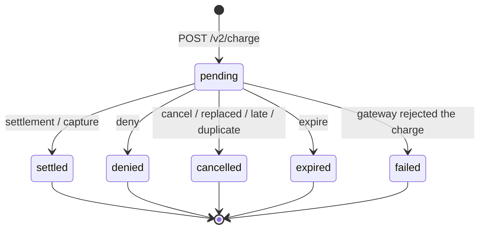
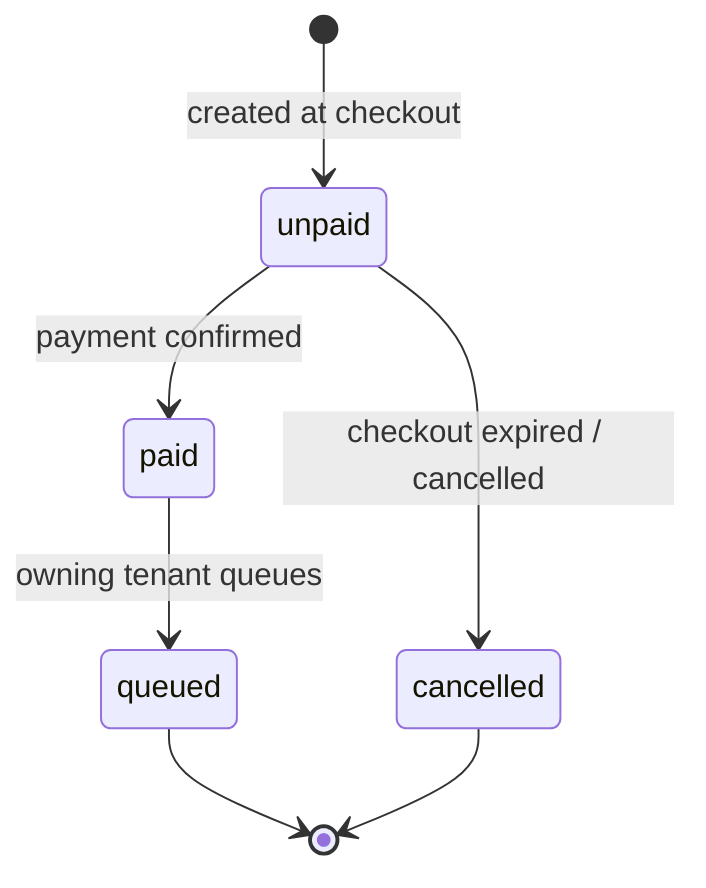
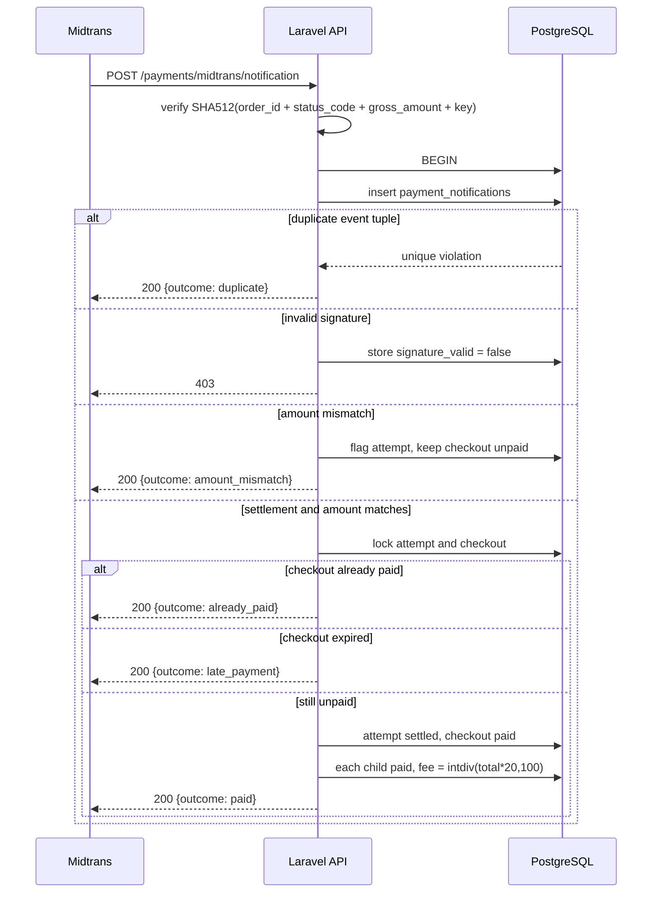
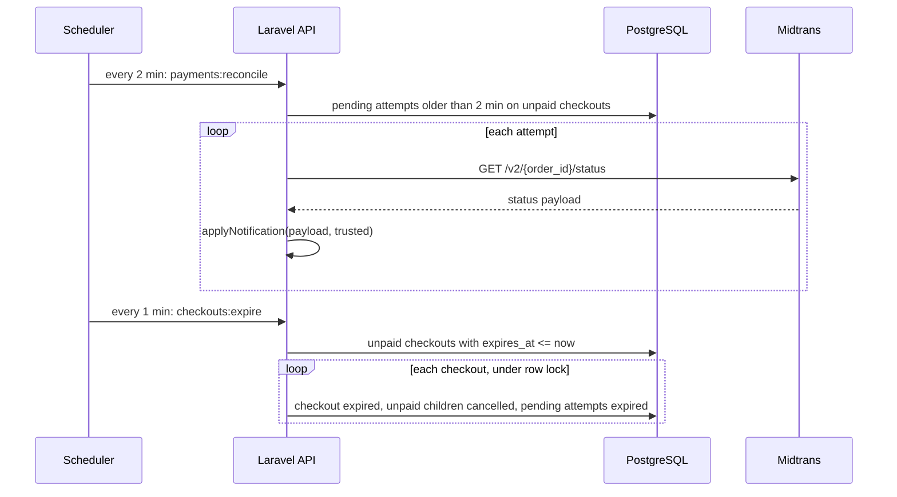
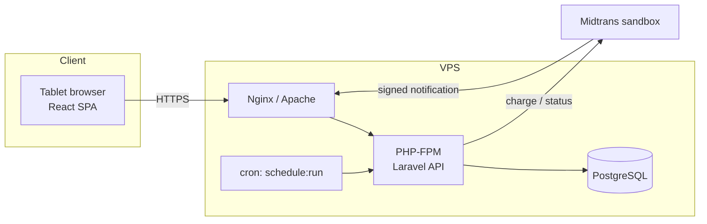

# Diagrams (BAB III)

Mermaid sources for the design chapter. GitHub renders them directly; export PNG/SVG from
<https://mermaid.live> for the thesis document. Keep them in sync with `BSD.md` and the code.

## 1. Entity relationship diagram



The isolation boundary sits at `TENANT_ORDERS.tenant_id`: every tenant-manager query is filtered by
it, and the unique `(checkout_id, tenant_id)` pair is what prevents a double split.

## 2. Checkout state



## 3. Payment attempt state



## 4. Tenant order state



## 5. Sequence: checkout, split, charge

```mermaid
sequenceDiagram
    actor C as Customer
    participant K as Kiosk (React)
    participant A as Laravel API
    participant D as PostgreSQL
    participant M as Midtrans

    C->>K: add items from several tenants
    K->>A: POST /cart/quote
    A-->>K: totals from product records
    C->>K: Bayar dengan QRIS
    K->>A: POST /checkouts + Idempotency-Key
    A->>D: SELECT checkout by idempotency_key
    alt key already used, same cart
        A-->>K: 200 original checkout (replayed)
    else key already used, different cart
        A-->>K: 409
    else new key
        A->>D: BEGIN; checkout + checkout_items + tenant_orders
        A->>D: COMMIT
        A->>D: insert payment_attempt (pending)
        A->>M: POST /v2/charge (qris, order_id, gross_amount)
        M-->>A: qr_string, expiry_time, actions
        A->>D: update attempt (qr, expiry)
        A-->>K: 201 checkout + child orders + QR
    end
```

## 6. Sequence: payment notification



## 7. Sequence: reconciliation and expiry



## 8. Deployment



In development, Vite serves the SPA on port 5173 and Laravel on 8000; a tunnel (ngrok or
cloudflared) exposes only the notification endpoint to Midtrans.
